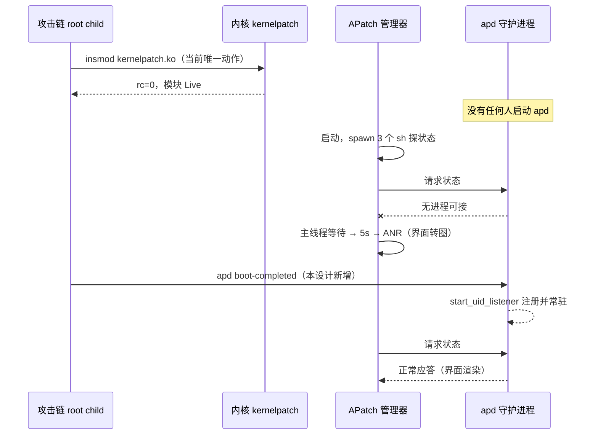

# APatch/KPM 路线设计：让 handoff 补跑 apd 开机阶段

- 状态：已实现并通过门禁，真机结果见 `docs/analysis/2026-10-27-apatch-kpm-gate.md`
- 日期：2026-10-27
- 级别：L（跨 native 脚本 ↔ 设备端 daemon 生命周期；影响 handoff 契约与文档）
- 分支：`marble-closeout-2026-10-25`

## 0 结论摘要

攻击链现在只做 `insmod`，把 `kernelpatch.ko` 塞进内核就结束。APatch 的管理器
界面需要的另一半——常驻 `apd` 守护进程与开机阶段事件——没有人跑，于是管理器
发请求没人接，界面转圈、5 秒后 ANR。

本设计在 **APatch 分支**的 `insmod` 成功之后，按 APatch 自己的开机顺序补跑
`post-fs-data` → `services` → `boot-completed`（最后一个常驻），并轮询确认守护
进程已起。改动集中在 `src/core/attack/ops.cpp` 的 handoff 脚本文本，不碰攻击
路径，不新增 profile 字段，失败不致命。

## 1 问题与目标

### 1.1 现象

`su -c 'id -u'` 返回 0（一次性重定向有效），但打开 APatch 管理器一直转圈，
5 秒后系统判 `Input dispatching timed out`。

### 1.2 现场证据（2026-10-27 实测）

| 观测 | 数据 |
| --- | --- |
| 管理器启动后的子进程 | 3 个 `/system/bin/sh`，pid 14794 / 14796 / 14814 |
| 它们的状态 | `state: S`，`wchan: pipe_read`（都在等自己的 stdin） |
| 守护进程 | `pidof apd` 为空 |
| 手动起 `apd boot-completed` 后 | `[start_uid_listener] Registering...`，pid 18932 |
| 管理器界面 | 立刻渲染：越狱模式 / KernelPatch 0.13.9 / APatch 11282 / Xiaomi Redmi 23049RAD8C |
| 杀掉它的父 adb shell 后 | pid 18932 仍存活（自行驻留） |

### 1.3 目标

1. 一次攻击成功后，APatch 管理器界面可用（含 KPM 内核模块页）。
2. `su` 行为不变。
3. 不碰 boot、不刷机、不改变"临时 root"的性质。

### 1.4 非目标

- 不做持久 root（需要 boot 集成，用户已排除）。
- 不代做 `apd soft-reboot`，不自动跳转管理器（既有产品决定）。
- 不修 MIUI 后台回收。

## 2 事实基线（代码锚点）

| 事实 | 出处 |
| --- | --- |
| 默认 loader 是 KernelSU | `src/core/profile/model.h:35` `handoff_module_loader` 无初值 → 零初始化 0；`src/core/attack/ops.cpp:408-410`：`1\|2` → `apd ksud`，其它 → `ksud apd` |
| 字段序列化 | `src/core/profile/binary.cpp:163` `PLAIN("module_loader", execution.handoff_module_loader)` |
| APatch 分支 | `src/core/attack/ops.cpp:436-464`，`:459` `"$LOADER" insmod "$APKO"`，`:461` 记 rc |
| 分支后立刻进模块等待循环 | `src/core/attack/ops.cpp:475-486` |
| 管理器界面滞后是已知项 | `README.md:21` / `README_ZH.md:21`；`docs/analysis/2026-10-26-marble-closeout.md` §6 第 2 条 |
| apd 子命令 | `post-fs-data` / `services` / `boot-completed` / `uid-listener` / `insmod`（jailbreak）/ `soft-reboot` / `late-load` / `module` |
| 上游定位 | `apd` 源码 `late_load.rs`：jailbreak 模式 "mirroring KernelSU's late-load flow"；管理器界面自述"越狱模式 / 该模式下不允许修补" |

## 3 逻辑链：为什么现在转圈



关键点：`su` 走的是**一次性**路径——内核 `sucompat` hook 把
`execve("/system/bin/su")` 重定向到 `apd`，`apd` 执行 `root_shell()` 跑完一条
命令就退出（`apd/src/apd.rs` 的 `root_shell()`）。它不需要常驻，所以 `su` 好
用；管理器要的是**常驻服务**，两者不是同一件事。

## 4 设计

### 4.1 改动位置

只改 `src/core/attack/ops.cpp` 里 handoff 脚本文本的 APatch 分支
（`:436-464`），在 `:461` 记录 `insmod rc` 之后插入。KernelSU 分支不动。

### 4.2 脚本改动（伪代码）

```sh
echo "[*] apd insmod rc=$IRC" >>"$LOG"
if [ "$IRC" -eq 0 ]; then
  export KERNELPATCH_VERSION=$(cat /sys/module/kernelpatch/version 2>/dev/null)
  export KERNEL_VERSION=$(uname -r)
  "$LOADER" post-fs-data >>"$LOG" 2>&1
  echo "[*] apd post-fs-data rc=$?" >>"$LOG"
  "$LOADER" services >>"$LOG" 2>&1
  echo "[*] apd services rc=$?" >>"$LOG"
  if [ -z "$(pidof apd)" ]; then
    "$LOADER" boot-completed >>"$LOG" 2>&1 &
    APD_BG=$!
    i=0
    while [ $i -lt 30 ]; do
      if [ -r "/proc/$APD_BG/cmdline" ]; then break; fi
      i=$((i+1)); sleep 0.1
    done
    echo "[*] apd daemon pid=$APD_BG alive=$([ -r /proc/$APD_BG/cmdline ] && echo 1 || echo 0)" >>"$LOG"
  else
    echo "[*] apd daemon already running pid=$(pidof apd)" >>"$LOG"
  fi
fi
```

### 4.3 设计决定

| 编号 | 决定 | 理由 |
| --- | --- | --- |
| D1 | 只在 APatch 分支补跑阶段 | KernelSU 没有常驻层，补跑无意义 |
| D2 | 顺序固定 `post-fs-data` → `services` → `boot-completed` | 与 APatch 自身开机顺序一致；`post-fs-data` 依赖 `KERNELPATCH_VERSION`，`boot-completed` 负责注册 uid listener 并常驻 |
| D3 | `boot-completed` 必须 detach（`&`） | 它本身不返回；等它就是卡死 handoff |
| D4 | 起之前先查 `pidof apd` | 幂等：重复跑不叠加守护进程 |
| D5 | 任一阶段失败只记日志，不 exit | `su` 不依赖守护进程；不能因为管理器功能失败而毁掉已拿到的 root |
| D6 | 不新增 profile 字段 | `handoff_module_loader` 已经决定走哪条路；阶段动作是该路径的固有部分 |
| D7 | 用 `$!` + `/proc/<pid>/cmdline` 判存活 | `pidof apd` 对 staged 的 `libapd.so` 名字不匹配，不能用它确认自己刚起的那个 |

### 4.4 环境变量

`apd post-fs-data` 在没有环境变量时报
`KERNELPATCH_VERSION not found` / `KERNEL_VERSION not found` 并跳过后续动作；
设上之后 `rc=0` 且打印版本。取值：

- `KERNELPATCH_VERSION` ← `/sys/module/kernelpatch/version`（本机 `0.13.9`）
- `KERNEL_VERSION` ← `uname -r`

## 5 边界与失败处理

| 场景 | 行为 |
| --- | --- |
| `insmod` 失败（rc≠0） | 不跑阶段（现有逻辑已 exit 1） |
| `post-fs-data` 失败 | 记 rc，继续跑 `services` / `boot-completed` |
| 守护进程已在跑 | 跳过启动，记录已有 pid |
| 守护进程 3 秒内没起来 | 记 `alive=0`，继续走完 handoff（`su` 仍可用） |
| 攻击链之后被 force-stop | 守护进程可能随之消失；重新点执行会重建（D4 保证不叠加） |
| 设备重启 | 模块与守护进程都消失（临时 root 的固有性质，非本设计引入） |

## 6 备选方案

| 方案 | 做法 | 取舍 |
| --- | --- | --- |
| A（本设计） | handoff 补跑三阶段 + 常驻 daemon | 管理器与 KPM 可用；改动 10 余行脚本；不碰攻击路径 |
| B | 默认改回 KernelSU，放弃 APatch | 活动部件最少，但用户明确要 KPM，排除 |
| C | 只跑 `boot-completed`，不跑前两个 | 界面能开，但模块挂载/服务脚本没跑，KPM 可能装不上；不选 |
| D | 让用户手动起守护进程 | 把内部细节推给用户，不可接受 |

## 7 影响面

| 文件 | 改动 |
| --- | --- |
| `src/core/attack/ops.cpp` | handoff 脚本 APatch 分支 +约 14 行 |
| `README.md` / `README_ZH.md` | 第 21 行补一句：APatch 路线会自动拉起 `apd`，管理器无需手动处理 |
| `docs/analysis/2026-10-26-marble-closeout.md` | §6 第 2 条从"已知缺口"改为"已处理（附真机证据）" |

不改：`src/core/profile/*`（无新字段）、Kotlin 侧、wire 格式、攻击路径
（waiter / race / payload / route）。

## 8 验证计划

### 8.1 门禁

1. `build\rebuild-native.ps1` 零告警。
2. `py tools\cmp_disasm.py <基线> build\native\ghostlock`：8 个攻击函数要求
   IDENTICAL 或已复核注解差异（`write_root_script` 不在比对集合内，但需确认
   没有连带变化）。
3. `build\lint_all.bat` → `TIDY_STATUS=0`。
4. `make -C src native-host-tests` 27/27。

### 8.2 真机矩阵（marble 3e6f1443）

| 用例 | 步骤 | 判据 |
| --- | --- | --- |
| T1 管理器可用 | 冷机 → 跑一轮 → 开管理器 | 5 秒内渲染主页，无 ANR |
| T2 KPM 可用 | 管理器 KPM 页 → 安装/启用一个 KPM | 模块出现在列表且能启用 |
| T3 su 不变 | 命中后 `su -c 'id -u'` | 0 |
| T4 幂等 | 同 boot 内重复跑（已 root 守卫会拦，需临时关） | 不出现第二个 apd |
| T5 KernelSU 路径不回归 | 选择器切 KernelSU 跑一轮 | `kernelsu.ko` 加载，`su` 可用，不跑阶段 |
| T6 失败降级 | 故意让 `post-fs-data` 失败（临时改名 kptools） | handoff 仍完成，`su` 仍 0 |

### 8.3 记录

真机结果写入 `docs/analysis/2026-10-27-apatch-kpm-gate.md`，含日志片段与
`run` 目录名。

## 9 风险与回滚

| 风险 | 处置 |
| --- | --- |
| `post-fs-data` 会执行 `/data/adb/modules/*/post-fs-data.sh`，本机还留着 `ghostlock-panic`（写 `panic_on_oops=1`、`panic=5`） | 实施前先删该模块，或明确接受"内核 oops 直接重启"的行为 |
| APatch 版本升级后子命令/环境变量名变化 | 脚本对未知子命令只记 rc，不 exit；门禁 T1/T2 会抓到 |
| 守护进程持有 fd 影响 fork-hold 收尾 | 观察 T1 的 `fork-hold parked` 是否仍出现；必要时给 daemon 重定向到 /dev/null |
| 误改 KernelSU 分支 | 改动限定在 `*libapd.so)` 分支内，T5 覆盖 |

回滚：还原 `ops.cpp` 该段字符串；设备侧 `kill $(pidof apd)` 即可回到当前行为。

## 10 不做什么

- 不 patch boot、不做持久 root。
- 不代做 `soft-reboot`、不自动跳转管理器。
- 不改 KernelSU 路径、不改 profile 格式。
- 不把 `apd` 打包进 APK（用管理器自带的 `libapd.so` 与 `/data/adb/ap/bin/apd`）。
