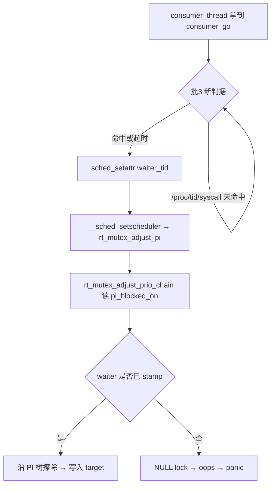

# 5.10 marble 移植 计划（2026-10-10）

## 现状与基线

- 分支 `main-510-port`，基线 commit `3d4306c`（`Merge pull request #335 from yourbestregard/main`），工作树干净。
- 目标设备：Redmi Note 12 Turbo / marble（`23049RAD8C`，Android 13，`uname -r` = `5.10.149-android12-9-00001-gda3d81545d1d-ab9545656`）。
- 上游支持的 route 与内核族：`multicast_waiter`（5.15）、`select_stack`（6.1 / 6.6 / 6.12）、`tcp_zerocopy`。**没有任何 5.10 条目**（`app/src/main/assets/kernel_profiles/index.conf` 共 30+ 条，全部落在 5.15 / 6.1 / 6.6 / 6.12）。
- 已知问题（本次要解决的两条）：
  1. 5.10 的 `rt_mutex_waiter` 是**第三种** compact 布局（`tree_entry@0x00 pi_tree_entry@0x18 task@0x30 lock@0x38 prio@0x40 deadline@0x48`，无 `wake_state` / `ww_ctx`），上游 native 只有 6.6（rb_node）与 6.1（compact + `wake_state@0x40`）两种表。直接用 6.1 表 ⇒ 往内核内存写错偏移。
  2. `select_stack` 每次 `pselect` 的存活率约 18%（`my2:src/core/main.c:703-718` 实测注释："every pselect has only ~18 percent chance of surviving"）。W1 × W2 全链 ≈ 3%；`my2` 靠 15 次重试把 W1 抬到 ~95%，**前提是 oops 不致命**。而 marble 的 `CONFIG_PANIC_ON_OOPS=y` / `CONFIG_PANIC_TIMEOUT=-1`，单次 oops 即整机重启 ⇒ 重试预算被静默吃掉，表现为「每轮都在重启」。用户要求：**整个过程都不重启**。

## 目标与约束

- 目标：在 marble 上装上 App 直接跑到 `child is root!`（uid=0），**搜索期与提权期都不重启**。
- 约束：所有改动必须落在上游 C++23 架构与 GLK1 v2 profile 契约内；执行层不得新增环境变量（AGENTS.md：只允许读 `GHOSTLOCK_HOME` / `TMPDIR` / `GHOSTLOCK_KSU_LOG`）；不改 wire、不改 Kotlin 侧 profile 键名、不新起 profile 版本号。
- 非目标：不做 APatch / KernelPatch handoff（上游无该路径）；不移植 my2 的 C 实现或 PC 侧 harness；不新增 WiFi/其它 route；不重写 `kernelsnitch/`。

## 改动清单

### 批 1 · native：三态 waiter 布局 + payload 分流

| 文件 | 改动 | 理由 |
| --- | --- | --- |
| `src/core/kernel/waiter_layout.hpp`（新增） | `FAKE_WAITER_PRIO`、`COMPACT_WAITER_6_1 = 1`、`COMPACT_WAITER_5_10 = 2` 与序数语义注释；**不 include `kernel/offset.h`**（host 测试安全） | 三态序数需要一个 host 可读的定义点；`constants.hpp` 依赖 `TARGET_CONFIG_H`，host 测试读不了 |
| `src/core/kernel/constants.hpp` | 删本地 `FAKE_WAITER_PRIO`，改为 include 新头 | 单一来源，避免两处常量漂移 |
| `src/core/profile/model.h` | 新增 `[[nodiscard]] uint8_t compact_waiter_kind() const noexcept`；`has_compact_waiter()` 语义不变（仍 `!= 0`） | 需要「第几种布局」而不只是「是不是 compact」；`compact_waiter` 是 `std::optional<uint8_t>`，2 全程合法 ⇒ **零 schema 改动** |
| `src/core/route/route_api.hpp` | 新增 `struct WaiterWord { int32_t word; uint64_t value; const char *name; };` 与 `select_stack_waiter_words(...)` 声明 | 把纯函数暴露给 host 测试，逐态断言字表 |
| `src/core/route/select_stack_route.cpp` | `select_stack_build_fdsets` 的 `if (compact)` 二分改为三态；新增 5.10 字表 | 5.10 表 = 6.1 表去掉 word 12（`ww_ctx`，5.10 结构体之外）且 word 10 改为裸 `FAKE_WAITER_PRIO`（5.10 无 `wake_state`，prio 直接在 0x40） |
| `src/core/support/util.cpp` | compact 分支按序数分流 W0 尾字 | 6.1：`put32(+0x40,0) / put32(+0x44,PRIO) / put64(+0x48,0) / put64(+0x50,0)`；5.10：`put32(+0x40,PRIO) / put32(+0x44,0) / put64(+0x48,0)`，**不写 0x50** |
| `src/core/tests/select_stack_route_test.cpp` | 新增三态断言 | 5.10 分支的 host 主战场 |

### 批 2 · profile：marble 5.10.149

| 文件 | 改动 | 理由 |
| --- | --- | --- |
| `app/src/main/assets/kernel_profiles/5.10.149-android12-9-00001-gda3d81545d1d-ab9545656.conf`（新增） | `kernel_major = 5`；`route { select_stack { waiter_shift = -2; enter_delay_us = 50000; timeout_us = 200000; compact_waiter = 2 } }`；`offset.*` 取 extractor 值；`task_struct` 15 项取 5.10 表 | `compact_waiter = 2` 即「5.10 compact」；`timeout_us` 对齐 my2 已验证的 `PSELECT_TIMEOUT_USEC 200000` |
| `app/src/main/assets/kernel_profiles/index.conf` | 登记新条目 | 按 `uname -r` 精确匹配 |

### 批 3 · 路径 A：消除「盲等」，把 18% 抬到接近 100%

| 文件 | 改动 | 理由 |
| --- | --- | --- |
| `src/core/race/threads.cpp` | `consumer_thread` 开火前不再无条件 `usleep(route_delay_usec)`，改为轮询 `/proc/<waiter_tid>/syscall` 直到 waiter 线程确实处于目标系统调用内（或超时兜底） | 当前盲等的语义是「赌 waiter 已经睡进 pselect 的 fd_set 栈缓冲」。赌错 ⇒ consumer 的 `sched_setattr` 让内核沿 `rt_mutex_adjust_prio_chain` 走一个尚未 stamp 的 ghost waiter ⇒ NULL `waiter->lock` ⇒ oops ⇒ panic。`/proc/<tid>/syscall` 是**零内核写**的观测面（设备实测：同 uid 可读，第一字段 = syscall 号） |
| `src/core/support/decls.hpp` | 新增判据函数的声明 | 与既有 `read_first_line` 同族 |
| `src/core/race/pi_race.h` | 若需新增观测/兜底字段 | 头里所有热路径成员都是 public |

判据细节：`proc_pid_syscall()` 有三种输出 —— `running`（未睡眠）、`<nr> 0xSP 0xIP`（`nr < 0` 异常态）、九字段 `<nr> arg0..arg5 SP IP`（睡眠中）。**必须三者都容忍**：`running` 与异常态都算「还没到位」继续等，只有九字段且 `nr` 命中目标号才算到位。目标号在实现时按真实调用序确定（`__NR_pselect6 = 72` / `__NR_futex = 98`）。

### 批 4 · 重移植两个已证实的结构性修复

| 文件 | 改动 | 理由 |
| --- | --- | --- |
| `src/core/route/select_stack_route.cpp` + `route_api.hpp` + `cve_2026_43499_backend.cpp` | 新增 `reserve_low_fds()`（把低位 fd 用 `/dev/null` 占满到 `PSELECT_ROUTE_NFDS`）并在 `run_setup()` 里 `route::reserve_standard_io();` 之前调用 | fd_set 的字**同时是 waiter 字段**：每个字的**值**也会变成 fd 位图。W1 的值是 payload 页（低字节 `0x00`），W2 的值是 `init_cred` 别名（低字节 `0x30` ⇒ 额外点亮 fd 4/5）。`open_selected_fds()` 会把一个永不就绪的 fd `dup2` 到**每一个**置位的 fd 上 ⇒ 静默劫持 fd 4/5 上的 harness 管道。这正是「W1 存活 ~22%、W2 0/30」的结构性差异 |
| `src/core/session/victim_process.cpp` | 新增 `raise_pipe_fd()`，在 `spawn_child()` 的三个 `pipe()` 之后、交给 `UniqueFd` 之前把 6 个端全部抬到 `PSELECT_ROUTE_NFDS + 96` 之上 | 128 个 park fd 只覆盖 3..130，位图覆盖 0..319；且 word 2/7 是 `fake_right` 与 `target` 的 OR，`target` 值同样会点亮低位 fd |

> 这两项在 origin/main 上**不存在**（全仓 grep `reserve_low_fds|low_fd_park|is_reserved_low_fd|raise_pipe_fd` = 零命中），历史上它们把 W1 存活从 0/30 抬到 ~22%、并让 W2 首次进入 pselect。

## 数据流/控制流差异

**不变量**：
1. waiter 字表的每个字仍落在 `words_per_set = 5` 的可寻址窗口（`global_word 0..14`）内，越界只 `pr_warning` 不中断。
2. `compact_waiter` 缺省（0）时行为与上游逐字节相同（6.6 分支）。
3. `compact_waiter = 1` 时行为与上游逐字节相同（6.1 分支）——**已有 6.1 profile 的机型不受影响**。
4. GLK1 v2 字段表与 Kotlin 键名逐字不变。
5. 执行层仍然只读那三个允许的环境变量。

## 兼容性与回滚

- 兼容：新序数只在 `compact_waiter = 2` 时生效；1 与 0 的路径逐字节不动 ⇒ 已支持机型零风险。
- 回滚：批 1/2 是纯增量（新文件 + 新分支），`git revert` 单批即可；批 3 保留「超时兜底」分支，最坏退化为旧行为（`route_delay_usec` 上限）；批 4 的两个函数互相独立，可分别回退。
- 设备侧回滚：删掉新增 profile 与 `index.conf` 条目即可回到「不受支持」。

## 验证矩阵

| 批次 | 命令 | 预期 |
| --- | --- | --- |
| 批 1 | `make -C src ghostlock` | 零告警，产物 `build/native/ghostlock` |
| 批 1 | `make -C src native-host-tests` + WSL `bash build/run_host_tests.sh` | 全绿（x86 无 `yield` 的 `tcp_zerocopy_route_test` 为既有失败） |
| 批 1 | `make -C src lint-tidy` | 0 findings |
| 批 3 | `python3 tools/cmp_disasm.py <baseline> <candidate>` | 8 个关键函数布局判据通过（consumer 路径允许变化，需逐条确认） |
| 批 2 | `.\gradlew.bat :app:assembleDebug` | APK 产出，`jniLibs/arm64-v8a/libghostlock.so` 含新串 |
| 批 2/3/4 | 真机 `adb -s 3e6f1443 install -r <apk>` 后跑 App | **不重启** + `child is root!`；归档到 `docs/analysis/device-gates/` |

## 明确保留

- `multicast_waiter`：marble 几何上不可用（`required = waiter_off 336 + max(task,lock) 56 + 8 = 400 > buffer_size 264`），本计划不碰。
- `tcp_zerocopy`：5.10 真实 `struct tcp_zerocopy_receive` 仅 `0x28` < 需要的 `0x38`，内核 EINVAL 拒，本计划不碰。
- `kernelsnitch/`：AGENTS.md 禁止顺手重写；本计划只按 profile 传 `mm_struct_sz` / `collisions`。
- Kotlin 侧：除 `index.conf` 登记外一行不改。

## 进度

- [x] 基线与目标代码逐行核对（waiter 字表 / payload / consumer / route_api / 后端调用链）
- [x] 基线构建验证（`make -C src ghostlock` exit 0）
- [ ] 批 1 native 三态 waiter 布局 + payload 分流
- [ ] 批 2 marble 5.10.149 profile + index.conf
- [ ] 批 3 路径 A 判据
- [ ] 批 4 `reserve_low_fds()` / `raise_pipe_fd()`
- [ ] 构建 + host 测试 + lint-tidy
- [ ] 真机门禁归档
